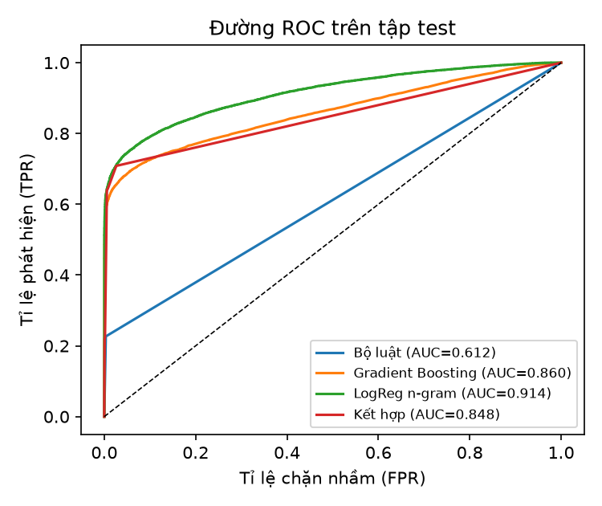
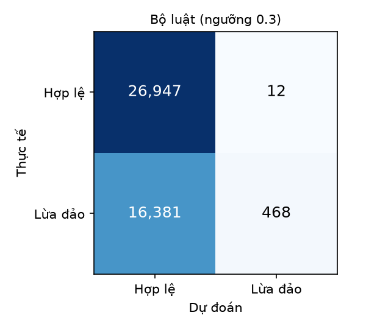
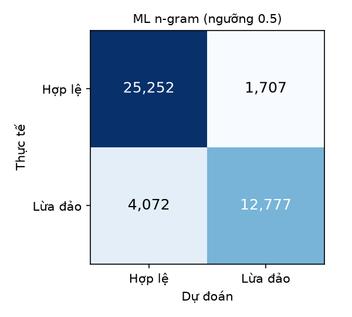
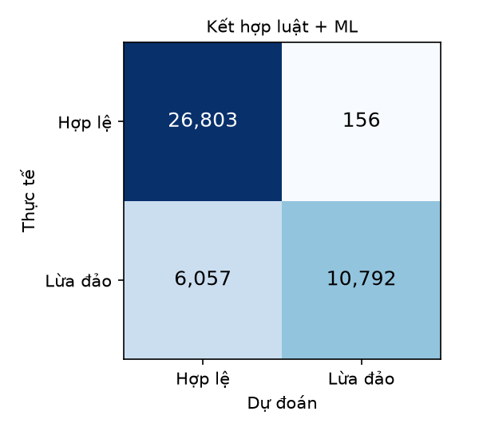

# Kết quả đánh giá PhishGuard

- Dữ liệu: PhiUSIIL Phishing URL Dataset (UCI, 2024), 219,036 tên miền sau khi làm sạch
  (84,244 lừa đảo / 134,792 hợp lệ).
- Chia train/test 80/20 phân tầng theo nhãn, `random_state=42`. Test: 43,808 tên miền.
- Chỉ dùng tên miền (bỏ `www.`, giao thức, đường dẫn) để tránh "mẹo" của dataset
  (100% URL hợp lệ có dạng `https://www.<domain>` không có đường dẫn).
- FPR = tỉ lệ trang hợp lệ bị chặn nhầm (càng thấp càng tốt).

## Kết quả trên tập test

| Phương pháp                             |   Accuracy |   Precision |   Recall |    F1 |   ROC-AUC |   FPR |
|:----------------------------------------|-----------:|------------:|---------:|------:|----------:|------:|
| Bộ luật (ngưỡng 0.3 – đáng ngờ trở lên) |      0.626 |       0.975 |    0.028 | 0.054 |     0.612 | 0.000 |
| Bộ luật (ngưỡng 0.6 – chỉ lừa đảo)      |      0.617 |       1.000 |    0.005 | 0.010 |     0.612 | 0.000 |
| ML: Gradient Boosting (18 đặc trưng)    |      0.851 |       0.930 |    0.663 | 0.774 |     0.860 | 0.031 |
| ML: Logistic Regression (n-gram ký tự)  |      0.868 |       0.882 |    0.758 | 0.816 |     0.914 | 0.063 |
| Kết hợp: luật + ML (cách backend dùng)  |      0.858 |       0.986 |    0.641 | 0.776 |     0.848 | 0.006 |

Thời gian xử lý trung bình: bộ luật 0.041 ms/tên miền, mô hình ML (bản JSON trong backend) 0.033 ms/tên miền.

### So sánh với Gemini trên mẫu 59 tên miền (cân bằng 2 nhãn)

| Phương pháp          |   Accuracy |   Precision |   Recall |    F1 |   ROC-AUC |   FPR |
|:---------------------|-----------:|------------:|---------:|------:|----------:|------:|
| Bộ luật (cùng mẫu)   |      0.492 |       0.000 |    0.000 | 0.000 |     0.567 | 0.000 |
| ML n-gram (cùng mẫu) |      0.797 |       0.909 |    0.667 | 0.769 |     0.921 | 0.069 |
| Gemini (chỉ xem URL) |      0.797 |       0.950 |    0.633 | 0.760 |     0.857 | 0.034 |

Gemini trả lời 59/60 lần, trung bình 2644 ms/lần (gồm cả thời gian chờ khi bị giới hạn).

## Biểu đồ

| Bộ luật | ML n-gram | Kết hợp |
|---|---|---|
|  |  |  |

## Mô hình học được gì (15 n-gram có trọng số lớn nhất mỗi phía)

| n-gram nghiêng về LỪA ĐẢO | trọng số | n-gram nghiêng về HỢP LỆ | trọng số |
|---|---|---|---|
| `^is-` | 2.95 | `^ci.` | -2.65 |
| `.cf` | 2.75 | `.ac.` | -2.51 |
| `nft` | 2.74 | `^co.` | -2.49 |
| `ga$` | 2.71 | `.ch$` | -2.06 |
| `.ga$` | 2.71 | `.se$` | -1.90 |
| `.we` | 2.65 | `nant` | -1.89 |
| `.bl` | 2.49 | `be$` | -1.78 |
| `.lo` | 2.49 | `etch` | -1.73 |
| `.fl` | 2.44 | `.mil` | -1.72 |
| `.tc` | 2.44 | `inera` | -1.71 |
| `dns` | 2.36 | `^ij` | -1.71 |
| `.my` | 2.35 | `.edu$` | -1.69 |
| `.ho` | 2.33 | `du$` | -1.69 |
| `.bi` | 2.32 | `edu$` | -1.69 |
| `.ze` | 2.27 | `.edu.` | -1.67 |

## Nhận xét

- Bộ luật có **độ chính xác (Precision) cao, FPR thấp** nhưng **bỏ sót nhiều** (Recall thấp): nó chỉ
  bắt các mẫu rõ ràng (giả mạo thương hiệu, đuôi tên miền rẻ, từ khóa dụ dỗ). Đây là lựa chọn có chủ đích
  để không chặn nhầm trang thật.
- Mô hình ML học được nhiều mẫu hơn nên Recall cao hơn hẳn, đổi lại chặn nhầm nhiều hơn.
- Backend dùng ML như **điểm cộng** cho luật (xem `app/ml.py`), sau đó trang có form đăng nhập
  còn được Gemini đọc nội dung trang, nên kết quả thực tế tốt hơn khi chỉ xét tên miền.
- Hạn chế: chỉ đánh giá trên tên miền; dữ liệu hợp lệ của PhiUSIIL chủ yếu là trang chủ của website
  quốc tế, ít tên miền Việt Nam.

_Tạo tự động bởi `eval/evaluate.py` trong 193 giây._
