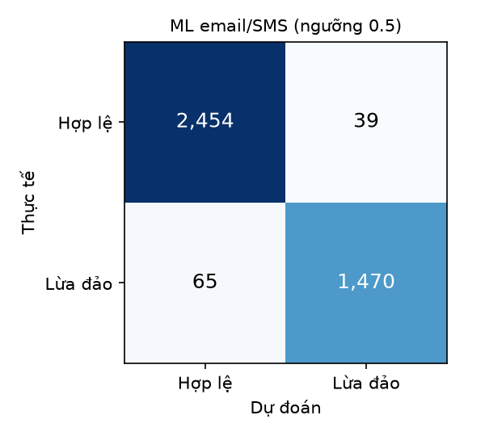

# Đánh giá mô hình email / tin nhắn

- Dữ liệu: ealvaradob/phishing-dataset (`texts.json`, email + SMS tiếng Anh, Apache-2.0),
  20,137 văn bản sau khi bỏ trùng (7,672 lừa đảo).
- Chia train/test 80/20 phân tầng, `random_state=42`. Test: 4,028 văn bản.
- Bộ luật email ở đây chỉ được xem nội dung (dataset không có người gửi / link riêng),
  nên thiệt thòi hơn khi chạy thật.

| Phương pháp                           |   Accuracy |   Precision |   Recall |    F1 |   ROC-AUC |   FPR |
|:--------------------------------------|-----------:|------------:|---------:|------:|----------:|------:|
| Bộ luật email (chỉ nội dung)          |      0.628 |       0.788 |    0.034 | 0.065 |     0.544 | 0.006 |
| ML: Logistic Regression (từ + cặp từ) |      0.974 |       0.974 |    0.958 | 0.966 |     0.996 | 0.016 |

Mô hình chỉ cho điểm khi văn bản có ít nhất 12 từ/cặp từ nó biết:
94% văn bản test đạt điều kiện này. Tin nhắn tiếng Việt thường không đạt,
khi đó hệ thống dựa vào bộ luật (có từ khóa tiếng Việt) và Gemini.

## Mô hình học được gì

| Từ nghiêng về LỪA ĐẢO | trọng số | Từ nghiêng về BÌNH THƯỜNG | trọng số |
|---|---|---|---|
| `mobile` | 1.22 | `enron` | -2.11 |
| `software` | 1.21 | `thanks` | -1.25 |
| `free` | 1.19 | `vince` | -1.23 |
| `txt` | 1.17 | `i'll` | -1.20 |
| `call` | 1.17 | `i` | -1.15 |
| `your` | 1.09 | `2002` | -1.13 |
| `http` | 1.06 | `attached` | -1.08 |
| `goodbye` | 1.06 | `ok` | -1.03 |
| `2005` | 1.06 | `url` | -0.99 |
| `sex` | 1.06 | `wrote` | -0.97 |
| `paliourg` | 1.05 | `enron com` | -0.96 |
| `reply` | 1.05 | `url http` | -0.95 |
| `hello` | 1.02 | `2000` | -0.91 |
| `chat` | 1.02 | `university` | -0.87 |
| `click here` | 1.01 | `louise` | -0.86 |

_Tạo bởi `eval/evaluate_text.py` trong 16 giây._
