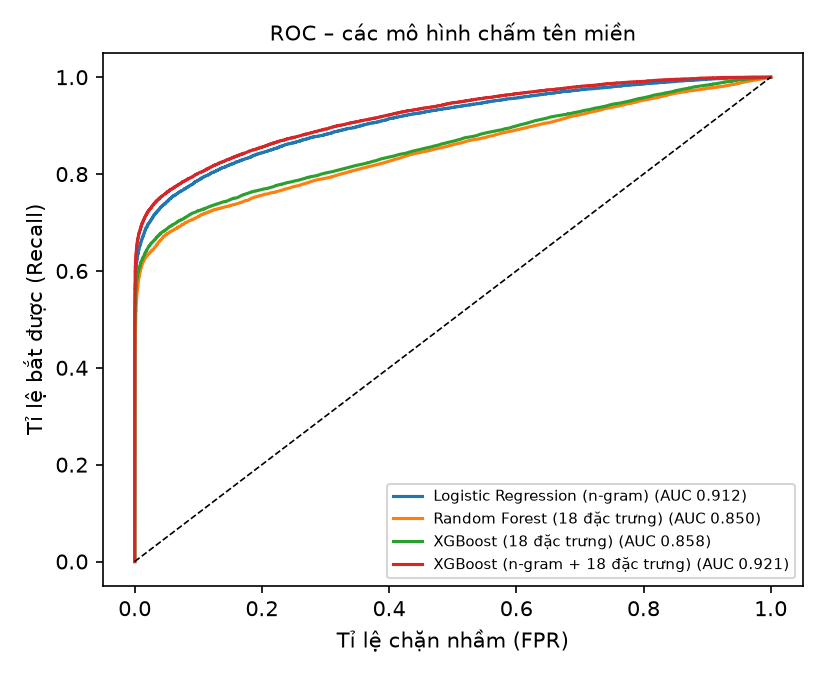
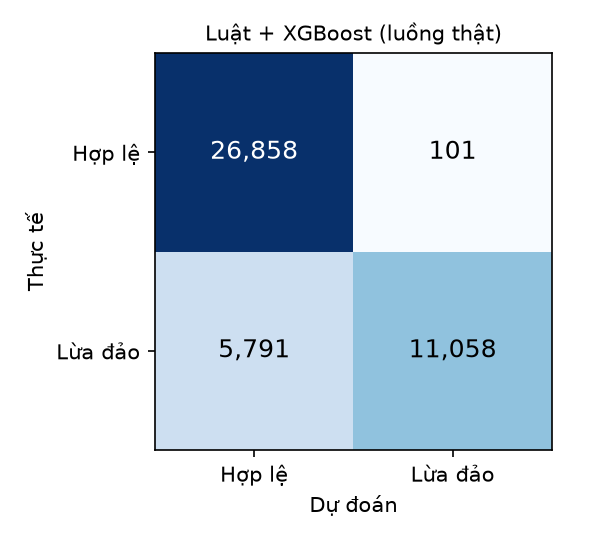
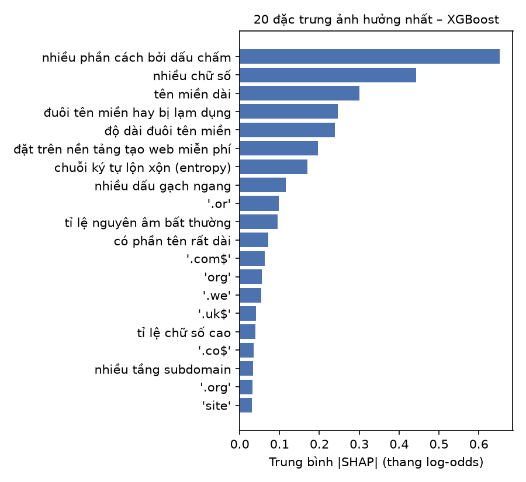

# Mô hình XGBoost chấm tên miền

- Dữ liệu: PhiUSIIL (UCI, 2024), 219,036 tên miền sau làm sạch; chia **giống** `eval/evaluate.py`
  (train/test 80/20, `random_state=42`). Tập train tách tiếp 10% làm **validation** để chọn ngưỡng.
  Fit 157,705 / Validation 17,523 / Test 43,808.
- Đặc trưng: n-gram ký tự 3–5 của tên miền (40,000 cụm) + 18 đặc trưng tự thiết kế
  (`app/url_features.py`, dùng chung lúc huấn luyện và lúc chạy). Không dùng đường dẫn/giao thức (lộ nhãn).
- XGBoost: 600 cây, sâu tối đa 8, learning rate 0.1.

## 1. Từng mô hình đứng riêng (ngưỡng 0.5, tập test)

| Phương pháp                                   |   Accuracy |   Precision |   Recall |    F1 |   ROC-AUC |   FPR |
|:----------------------------------------------|-----------:|------------:|---------:|------:|----------:|------:|
| Logistic Regression (n-gram) – mô hình cũ     |      0.867 |       0.877 |    0.760 | 0.814 |     0.912 | 0.067 |
| Random Forest (18 đặc trưng)                  |      0.845 |       0.904 |    0.670 | 0.769 |     0.850 | 0.045 |
| XGBoost (18 đặc trưng)                        |      0.851 |       0.928 |    0.665 | 0.775 |     0.858 | 0.032 |
| XGBoost (n-gram + 18 đặc trưng) – mô hình mới |      0.881 |       0.954 |    0.724 | 0.824 |     0.921 | 0.022 |

## 2. Trong luồng chấm thật của backend (luật + điểm cộng ML, tập test)

Điểm cuối ≥ 0.3 là "đáng ngờ" trở lên. ML không chấm tên miền chính chủ, `.gov/.edu`, trang phổ biến và đúng
tên máy của nơi người dùng tự đăng nội dung như docs.google.com (`service.ml_skipped`).
Ngưỡng cộng 0.3 điểm của XGBoost chọn trên **validation** = Recall cao nhất mà tỉ lệ chặn nhầm không vượt
mô hình cũ (0.668%):

| Ngưỡng | Recall (val) | FPR (val) |
|---|---|---|
| 0.50 | 0.727 | 2.309% |
| 0.55 | 0.714 | 1.781% |
| 0.60 | 0.701 | 1.317% |
| 0.65 | 0.690 | 1.085% |
| 0.70 | 0.681 | 0.900% |
| 0.75 | 0.670 | 0.677% |
| 0.80 | 0.659 | 0.473% |
| 0.85 | 0.647 | 0.380% |
| 0.90 | 0.627 | 0.297% |
| 0.95 | 0.590 | 0.167% |

Chọn **0.80**. Kết quả trên tập test:

| Phương pháp                            |   Accuracy |   Precision |   Recall |    F1 |   ROC-AUC |   FPR |
|:---------------------------------------|-----------:|------------:|---------:|------:|----------:|------:|
| Luật + LR (mô hình cũ, ngưỡng 0.9/0.7) |      0.858 |       0.986 |    0.641 | 0.777 |     0.847 | 0.006 |
| Luật + XGBoost (ngưỡng 0.80/0.70)      |      0.866 |       0.991 |    0.656 | 0.790 |     0.837 | 0.004 |

Trang thật hay dùng (`eval/legit_hosts.txt`, 261 trang) bị báo nhầm:
- Mô hình cũ (2): app.netlify.com, online.acb.com.vn
- XGBoost (5): dashboard.render.com, app.netlify.com, online.acb.com.vn, vpbank.com.vn, phishguard-backend-g3w0.onrender.com

(Danh sách này chỉ chạy luật + ML, không qua whitelist của server; ngân hàng VN như acb.com.vn, vpbank.com.vn
và chính trang PhishGuard nằm trong whitelist (`scripts/seed.py`) nên khi chạy thật không bị báo.)

## 3. Giải thích (SHAP)

Lưu ý: "nhiều phần cách bởi dấu chấm" đứng đầu vì PhiUSIIL **lệch về subdomain** (chỉ ~3,9% tên miền hợp lệ có
subdomain, lừa đảo ~55%), nên mô hình nghi ngờ mọi subdomain. Backend giảm tác hại bằng cách không cho học máy chấm
trang phổ biến / chính chủ (`service.ml_skipped`, `scripts/build_popular.py`); dữ liệu hợp lệ có subdomain là hướng
cải thiện tiếp theo.

Lúc chạy, `app/url_model.py` tính đóng góp từng đặc trưng theo đường đi trên cây (xấp xỉ Saabas của SHAP,
không cần thư viện) và trả 3 lý do mạnh nhất:

| Tên miền | Xác suất | Lý do |
|---|---|---|
| `secure-vietcombank-xacminh.top` | 100% | đuôi tên miền hay bị lạm dụng (+4.67); chứa tên thương hiệu (+1.08); chứa từ dụ đăng nhập/xác minh (+0.98) |
| `paypal-login.firebaseapp.com` | 100% | đặt trên nền tảng tạo web miễn phí (+2.69); nhiều phần cách bởi dấu chấm (+1.01); tên miền dài (+0.98) |
| `shopee-sale.vn` | 94% | chứa tên thương hiệu (+1.75); cụm ký tự 'shope' ở tên miền (+0.66); nhiều dấu gạch ngang (+0.43) |
| `tdmu.edu.vn` | 14% | nhiều phần cách bởi dấu chấm (+0.91); cụm ký tự '.vn' ở tên miền (+0.55); cụm ký tự '.vn' ở cuối tên miền (+0.22) |

## 4. Chạy trên server

- Mô hình xuất ra `app/url_model.json`, chấm bằng **Python thuần** (không cài xgboost trên Render, đỡ ~120 MB RAM).
  Lệch tối đa so với xgboost trên 3.000 tên miền: 7.2e-07.
- Thời gian chấm: 1.25 ms/tên miền (Python thuần, máy phát triển).

_Tạo tự động bởi `eval/train_url_xgb.py` trong 194 giây._
